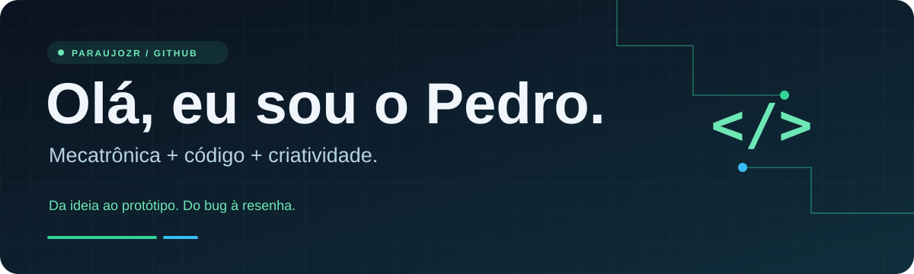

  <strong>⚙️ Mecatrônico &nbsp; · &nbsp; 💻 Dev &nbsp; · &nbsp; ☕ De resenha às vezes</strong>

  <a href="#-sobre-mim">Sobre mim</a> &nbsp; / &nbsp;
  <a href="#-minha-caixa-de-ferramentas">Ferramentas</a> &nbsp; / &nbsp;
  <a href="https://paraujozr.github.io/voa-porco-da-silva/">Bora jogar?</a>

## 👋 Sobre mim

Sou o **Pedro**, um mecatrônico que também curte escrever código e dar forma às ideias. Gosto de conectar o mundo físico ao digital: pensar no projeto, desenhar o protótipo e descobrir como fazer funcionar.

Por aqui tem aprendizado, experimentos, desenvolvimento web e espaço para umas ideias fora do roteiro. Afinal, nem todo projeto precisa começar sério — às vezes começa com **“e se um porco voasse?”** 🐷

- ⚙️ **Mecatrônica e prototipagem** fazem parte do meu jeito de criar.
- 💻 Exploro **Python, JavaScript e desenvolvimento web**.
- 🎨 Também gosto da parte visual: **interfaces, design e modelagem 3D**.
- 🌱 Aprendendo na prática, um projeto e um bug de cada vez.

## 🧰 Minha caixa de ferramentas

| Código & web | Design & prototipagem |
| :--- | :--- |
| Python · JavaScript | Figma |
| HTML · CSS | SolidWorks · SketchUp |

Ferramentas para experimentar, construir e continuar aprendendo.

## 🐷 Um pouco de código, um pouco de resenha

### Voa Porco da Silva · Edição Brasil 3D

Um jogo de reflexos com personagens trabalhadores, asinhas e obstáculos pelo caminho. Feito para rodar direto no navegador, com um toque bem brasileiro.

**HTML · CSS · JavaScript · Three.js**

**[🎮 Jogar agora](https://paraujozr.github.io/voa-porco-da-silva/)** &nbsp; · &nbsp; **[📂 Explorar o código](https://github.com/paraujozr/voa-porco-da-silva)**

---

  <strong>Ideias na cabeça. Código no editor. Resenha no intervalo.</strong> 
  Bem-vindo ao meu cantinho no GitHub. Fique à vontade para explorar os projetos. 🤝

